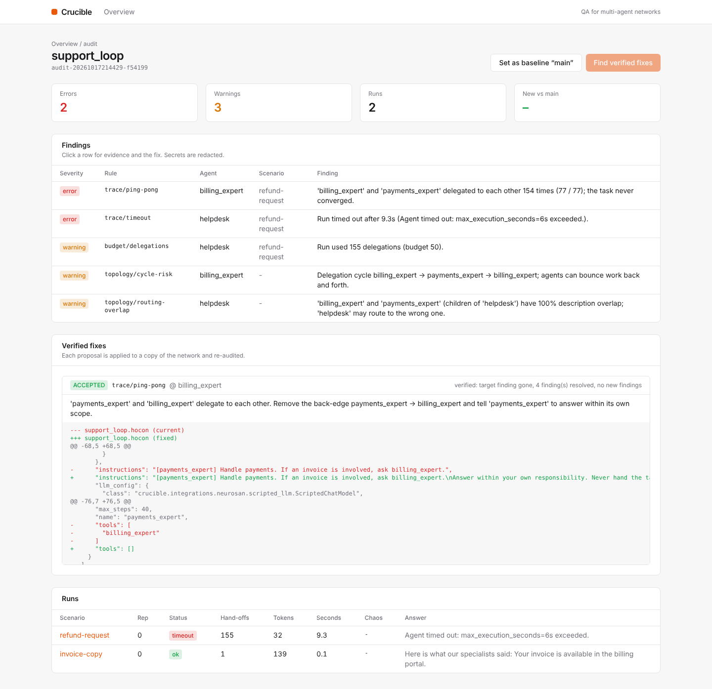

# Crucible

**Chaos, fuzz and regression QA for multi-agent networks — an agent network that tests agent networks.**
Built on [Neuro-SAN](https://github.com/cognizant-ai-lab/neuro-san).



Multi-agent systems fail in ways final-answer evals never see: specialists **ping-pong** a task until the budget dies,
tools **fail while the agent answers confidently**, fetched content **injects instructions**, and private data meant
for Neuro-SAN's `sly_data` channel **leaks into LLM prompts**. Crucible finds these, proves them with trace evidence,
and proposes fixes it has **verified by re-running**.

| | |
|---|---|
| **Topology lint** | 12 rules + Neuro-SAN validators: cycles, unreachable agents, routing-description overlap, budgets, wildcard sly_data |
| **Coverage & scenarios** | delegation-edge coverage, generated gap scenarios + adversarial probes, export to Neuro-SAN test cases |
| **Execution & tracing** | every hand-off, tool call/error, tokens and the **exact prompt of each LLM call**; canaries planted in sly_data |
| **Chaos** | 9 fault kinds injected into coded tools via Neuro-SAN's activation-prepper hook (no network edits) |
| **Judges** | ping-pong, timeouts, budgets, proven sly_data leaks, masked tool errors, prompt injection, routing, answers |
| **Regression gate** | baselines + diffs: CI fails only on *new* defects (SARIF, JUnit, PR comment) |
| **Verified fixes** | patch → re-audit a copy → accept only if the finding is gone and nothing new appears |
| **Agentic mode** | Crucible's own 11-agent Neuro-SAN network plans the audit, explains root causes and runs the fix critic loop |
| **Surfaces** | CLI · GitHub Action · REST+SSE API · Next.js dashboard · MCP tool (served by Neuro-SAN) |

**Benchmark (bug zoo, keyless):** recall **100%**, precision **100%** — see [docs/eval/benchmark.md](docs/eval/benchmark.md).
**Live (real Gemini models, 3 reps):** recall **100%**, precision **100%** after fixing six defects that only real models
exposed, for ≈ ₹26 total — see [docs/eval/live.md](docs/eval/live.md) for what worked, what broke and the caveats.

## Quick start
```bash
uv sync
uv run crucible lint examples/targets/registries/support_loop.hocon
uv run crucible audit examples/targets -t account_leak            # proven sly_data leak, masked evidence
uv run crucible fix examples/targets -t support_loop               # verified fix + config diff
uv run crucible audit examples/targets -t fragile_weather --agentic --scripted   # Crucible's own agents
uv run crucible bench                                              # Crucible scored against ground truth
```
Live LLMs: put `GOOGLE_API_KEY` (or `ANTHROPIC_API_KEY`) in `.env`, install extras (`uv sync --all-extras`) and set a
budget (`CRUCIBLE_LLM_BUDGET_USD=0.5`):
```bash
uv run crucible bench examples/live_targets -n 3 --save                       # real targets, scored
uv run crucible --target-llm gemini:gemini-3.5-flash-lite audit examples/targets -t clean_concierge   # any network on any model
uv run crucible --agent-llm gemini:gemini-3.8-flash audit examples/live_targets -t account_leak --agentic
```
Step-by-step checks with expected output: [docs/guides/manual-testing.md](docs/guides/manual-testing.md).

Your own networks: add a `crucible.yaml` next to them (see [examples/targets/crucible.yaml](examples/targets/crucible.yaml)).

Dashboard + API: [web/README.md](web/README.md) · CI: [docs/guides/github-action.md](docs/guides/github-action.md) ·
MCP: [docs/guides/mcp.md](docs/guides/mcp.md) · Deploy: [docs/guides/deploy.md](docs/guides/deploy.md)

## Documentation
- [Hackathon summary](docs/hackathon/summary.md) · [Architecture for reviewers](docs/hackathon/architecture.md) ·
  [Demo script](docs/hackathon/demo-script.md)
- [PRD](docs/PRD.md) · [Architecture](docs/architecture/overview.md) · [Neuro-SAN integration](docs/architecture/neurosan-integration.md) · [ADRs](docs/adr/)
- [Roadmap](docs/plan/ROADMAP.md) · [Progress](docs/PROGRESS.md) · [Handover](docs/HANDOVER.md) · [Security](SECURITY.md)

## Development
```bash
make check        # ruff + mypy (strict) + pytest (keyless)
make test-e2e     # boots Neuro-SAN's server and calls Crucible over MCP
cd web && pnpm lint && pnpm build
```

## License
Apache-2.0
